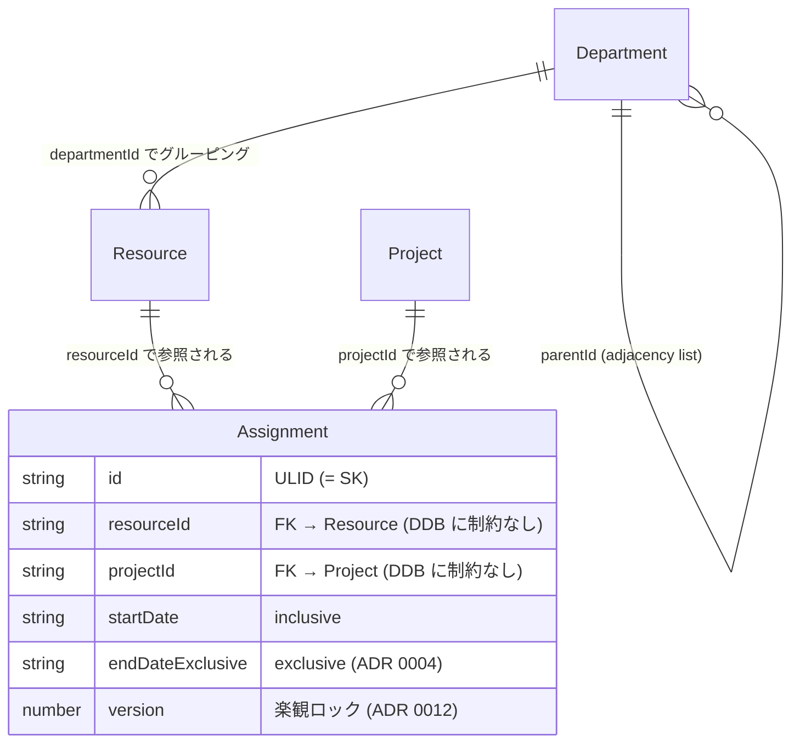

# Entities

DynamoDB シングルテーブル `resource-planner` に格納される全エンティティを定義する。
全アイテムは `pk = TEAM#{teamId}` で組織ごとにパーティション分割され、
`sk` のプレフィックスで entity 種別を表現する。

## ドメインの地図 (assign 中心)

このアプリの中核の事実は **Assignment** (「いつ・誰を・どの案件に」割り当てたか)。
Resource / Project / Department は Assignment が参照する **マスタ** であり、
timeline 画面と assignments 一覧画面はどちらも同じ Assignment を投影した **ビュー** にすぎない。



- **中核 = Assignment**: マスタを参照して初めて意味を持つ従属側。機能追加は基本ここを太らせる方向。
- **マスタ = Resource / Project / Department**: Assignment より先に独立して存在 (アサイン 0 件でも存在)。
- **ビュー = timeline (`/`) / assignments (`/assignments`)**: DB エンティティではない。同じ Assignment の見せ方違い。

## マルチテナント分離

- **PK = `TEAM#{teamId}`**: Team ID を埋め込む (`team_default` に自動 join される、ADR 0009 参照)。
  全 entity 共通のため、1 query で組織内全データ取得 (Scan 不要) が可能。
- **クロステナント混入防止**: app 層で常に session の `teamId` から PK を組み立て、
  client 入力をそのまま PK に使わない。

## Entity 一覧

### App entities (Team scope、`pk = TEAM#{teamId}`)

| Entity | SK パターン | 用途 |
|---|---|---|
| [Resource](#resource) | `RES#{resource_id}` | リソース (人/メンバー) |
| [Project](#project) | `PRJ#{project_id}` | 案件 (クライアント / 仕事) |
| [Assignment](#assignment) | `ASN#{assignment_id}` | リソース → 案件アサイン (ADR 0012: 安定キー + version 楽観ロック) |
| [Department](#department) | `DEPT#{department_id}` | 部署 (組織ツリーのノード、 ADR 0013: adjacency-list グルーピング) |
| Team meta | `META` | Team 自体のメタデータ (name, createdAt) |
| Team membership | `MEMBER#{userId}` | Team の所属メンバー (role) |

### Auth.js entities (`@auth/dynamodb-adapter` 管理、ADR 0008)

| Entity | PK | SK | 用途 |
|---|---|---|---|
| User | `USER#{userId}` | `META` | 認証ユーザー (email, name, emailVerified) |
| Account | `USER#{userId}` | `ACCOUNT#{provider}#{providerAccountId}` | 連携プロバイダ (Magic Link は無し、Microsoft Entra ID 後付け時) |
| Session | `SESSION#{token}` | `META` | DB session (TTL = `expires`) |
| VerificationToken | `VERIFICATION#{token}` | `META` | Magic Link 一時トークン (TTL = `expires`) |

### GSI1 (3 用途を兼用、ADR 0009)

| 用途 | GSI1PK | GSI1SK |
|---|---|---|
| Auth.js: User by email | `USER#email#{email}` | `USER#email#{email}` |
| Auth.js: User by account | `ACCOUNT#{provider}` | `ACCOUNT#{providerAccountId}` |
| App: user → 所属 team 一覧 | `USER#{userId}` | `TEAM#{teamId}` |

---

## Resource

人 (メンバー) を表す。各組織内でユニーク。

- **PK**: `TEAM#{teamId}`
- **SK**: `RES#{resource_id}`

| Field | Type | 説明 |
|---|---|---|
| `id` | str (ULID) | resource の主キー (sk と内部 attribute の二重保持) |
| `name` | str | 表示名 |
| `departmentId` | str (optional) | 所属 [Department](#department) の `id` (#239)。 属性なし = 未所属 |

サンプルアイテム:
```json
{
  "pk": "TEAM#team_default",
  "sk": "RES#01HXYZ...",
  "id": "01HXYZ...",
  "name": "山田 太郎"
}
```

---

## Project

案件 (クライアント) を表す。

- **PK**: `TEAM#{teamId}`
- **SK**: `PRJ#{project_id}`

| Field | Type | 説明 |
|---|---|---|
| `id` | str (ULID) | project の主キー |
| `name` | str | プロジェクト名 |
| `color` | str (`#RRGGBB`) | タイムラインでの表示色 |
| `description` | str (optional) | 案件説明 markdown raw (最大 10,000 文字、 ADR 0010)。 未設定なら attribute なし |
| `tags` | list of str (optional) | 使用技術タグ (最大 20 件 / 各 30 文字、 NFC normalize + dedup、 ADR 0010)。 未設定なら attribute なし |
| `links` | list of map (optional) | 関連リンク (最大 10 件、 http(s) のみ)。 各要素 `{ label?: str, url: str }` (ADR 0010)。 未設定なら attribute なし |

> **REMOVE semantics**: description 空文字 / tags 空配列 / links 空配列 は repository 層で 「未設定」 に正規化し、 attribute ごと REMOVE する。 「保存されているけど空」 状態は意図的に作らない (ADR 0010)。

サンプルアイテム (詳細あり):
```json
{
  "pk": "TEAM#team_default",
  "sk": "PRJ#01HABC...",
  "id": "01HABC...",
  "name": "Acme 移行案件",
  "color": "#4D72F3",
  "description": "## 概要\n基幹システム刷新。\n\n## 使用技術\n- TypeScript\n- AWS Lambda",
  "tags": ["TypeScript", "AWS Lambda", "DynamoDB"],
  "links": [
    { "label": "案件 Wiki", "url": "https://wiki.example.com/acme" },
    { "url": "https://example.com/spec.pdf" }
  ]
}
```

サンプルアイテム (詳細なし、 後方互換):
```json
{
  "pk": "TEAM#team_default",
  "sk": "PRJ#01HABC...",
  "id": "01HABC...",
  "name": "Acme 移行案件",
  "color": "#4D72F3"
}
```

---

## Assignment

「いつ・誰を・どの案件に」割り当てたかを表す関連 entity。

- **PK**: `TEAM#{teamId}`
- **SK**: `ASN#{assignment_id}` (ADR 0012: **安定キー**。 startDate は SK に含めない)
  - 旧: `ASN#{start_date}#{assignment_id}`。 startDate を SK に埋めると移動/リサイズのたびに SK rename (delete+put) が必要で、 連続操作・同時編集で条件失敗していた (ADR 0012)。
  - 並び替え (startDate 順) は client (`assignments/+page.svelte`) の責務。 DB の物理順は ULID 順。

| Field | Type | 説明 |
|---|---|---|
| `id` | str (ULID) | assignment の主キー (= SK の `ASN#` 以降) |
| `resourceId` | str | 紐づく [Resource](#resource) の `id` (FK 制約は DDB に無い) |
| `projectId` | str | 紐づく [Project](#project) の `id` (FK 制約は DDB に無い) |
| `startDate` | str (`YYYY-MM-DD`) | アサイン開始日 (**inclusive、この日を含む**)。通常属性 (SK には埋めない) |
| `endDateExclusive` | str (`YYYY-MM-DD`) | アサイン終了日の翌日 (**exclusive、この日は含まない**)。半開区間 `[startDate, endDateExclusive)` (ADR 0004) |
| `version` | number | 楽観ロック (ADR 0012)。 create で 1、 update のたびに +1。 client が read した値を `expectedVersion` として送り、 `version = :expected` 条件で書き込む。 不一致なら 409 |

> **endDateExclusive の解釈**: 「5/1〜5/31 のアサイン」 = `startDate=2026-05-01`, `endDateExclusive=2026-06-01`。最終作業日 (5/31) ではなく、その翌日 (6/1) を保存する。RFC 5545 / Google Calendar API / PostgreSQL daterange と同じ規約。

サンプルアイテム (2026-05-01 〜 2026-05-31 のアサイン):
```json
{
  "pk": "TEAM#team_default",
  "sk": "ASN#01HDEF...",
  "id": "01HDEF...",
  "resourceId": "01HXYZ...",
  "projectId": "01HABC...",
  "startDate": "2026-05-01",
  "endDateExclusive": "2026-06-01",
  "version": 1
}
```

---

## Department

組織ツリーのノード (部署/課/本部)。 1 Team 内の **グルーピング専用** (隔離境界ではない、 ADR 0013)。

- **PK**: `TEAM#{teamId}`
- **SK**: `DEPT#{department_id}` (**adjacency list**: 親 ID を通常属性 `parentId` で持つ)

| Field | Type | 説明 |
|---|---|---|
| `id` | str (ULID) | department の主キー (= SK の `DEPT#` 以降) |
| `name` | str | 部署名 (兄弟内で一意、 ADR 0013) |
| `parentId` | str (optional) | 親 Department の `id`。 **属性なし = ルート** (read で `null` 正規化)。 1 Team 内にルートは複数可 (フォレスト) |

> ツリーは `queryAllByTeam` が返すフラットな `DEPT#` item 群から client/server が in-memory で組む
> (ADR 0013、 materialized path/GSI は導入しない)。 Resource の所属 (`departmentId`) は #239 で追加。

サンプルアイテム (ルート + 子部署):
```json
{ "pk": "TEAM#team_default", "sk": "DEPT#01HROOT", "id": "01HROOT", "name": "開発本部" }
{ "pk": "TEAM#team_default", "sk": "DEPT#01HCHILD", "id": "01HCHILD", "name": "バックエンド課", "parentId": "01HROOT" }
```

---

## 設計意図

- **Single Table Design**: 1 query で組織内全データ取得を効率的にしたい (リソース計画 UI は組織全体を一度に表示するユースケース)。Resource / Project / Assignment を別テーブルに分けると 3 回の query / Scan が必要になる
- **`pk = TEAM#...` で固定**: マルチテナント isolation を物理的に強制 (PK が違えば物理的に到達不能)
- **`ASN` の SK は `ASN#{id}` 安定キー (ADR 0012)**: startDate は頻繁更新属性なので SK に入れない (キー rename を避ける)。 現状 assignment の期間 range query は無く全件取得 + client ソートで足りるため、 startDate を SK から外しても支障はない。 将来 DB 側で期間 range query が要るなら startDate を載せた GSI を新設する。 更新は `version` 属性 + 条件付き書き込み (楽観ロック) で同時編集の lost update を検出する
- **半開区間 `[start, end)` 規約**: 業界標準 (RFC 5545 / Google Calendar / PostgreSQL daterange / Java / Rust / Python) に整合。隣接区間 (5/1〜5/3 と 5/3〜5/5) が境界で接して重ならない。詳細 [ADR 0004](../adr/0004-end-date-exclusive-with-form-transform.md)
- **FK 整合性は app 層で担保**: DynamoDB は外部キー制約を持たないため、Resource / Project の delete 時に Assignment を残骸として残さないようカスケード削除を app 層で `TransactWriteItems` で実装している ([ADR 0006](../adr/0006-cascade-delete-strategy.md))
